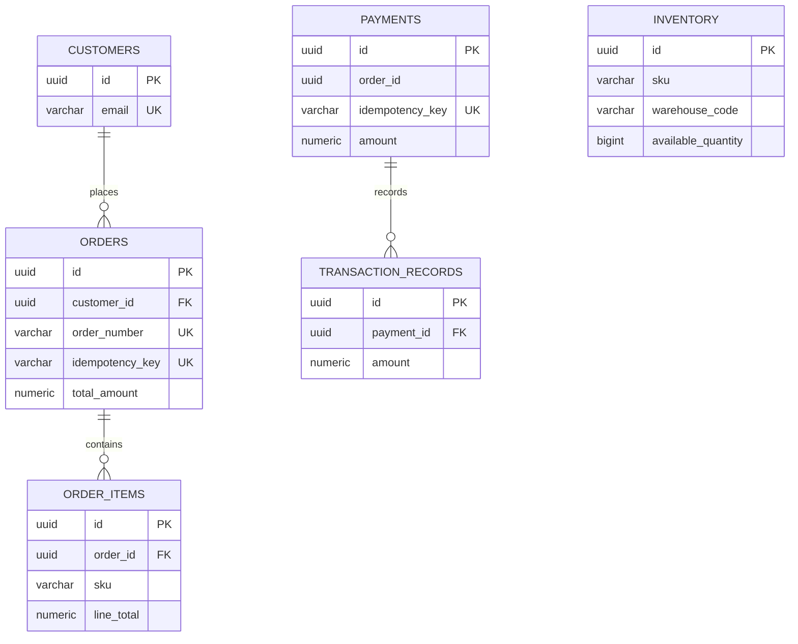

# Database Design

## Scope and ownership

Use PostgreSQL 17 with one database and three service-owned schemas initially.
The migration account physically owns schema objects for deployment; applications
use separate non-owner roles with access only to their own schema. This separates
deployment authority from logical service ownership.

| Service | Schema / tables | Responsibility |
| --- | --- | --- |
| Order | `order_service.customers`, `orders`, `order_items` | Customer profiles and order lifecycle; owns checkout price snapshots |
| Payment | `payment_service.payments`, `transaction_records` | Payment attempts and append-only provider operation observations |
| Inventory | `inventory_service.inventory` | Stock and reservation balances per SKU/warehouse |
| Notification | None yet | Consumes events; no direct reads/writes to another service's tables |

Customer ownership is assigned to order-service because there is no customer
service in the current scope. Revisit the boundary if identity/customer management
becomes independent. Customer rows contain no authentication credentials.

Foreign keys are restricted to tables owned by the same service. A payment's
`order_id` and an order item's `sku` are external references. Their existence and
business state must be verified through the owning service's APIs/events, not
cross-schema joins or foreign keys. This preserves a path to separate databases.

The diagram's email uniqueness is case-insensitive; transaction FK additionally
includes currency. Inventory intentionally has no FK to order items. Orders can be
inserted before their lines within one transaction; the service must reject an
empty finalized order.

## Keys, constraints, and indexes

All six tables use UUID primary keys with PostgreSQL's built-in
`gen_random_uuid()` default; no extension installation is required. Services may
supply UUIDs before publishing events. Natural/external keys are separate from PKs.

| Table | Constraints and lookup indexes |
| --- | --- |
| Customers | Unique `lower(email)`; trimmed nonblank email/name; ACTIVE/INACTIVE status |
| Orders | Unique order number and request idempotency key; customer FK with RESTRICT deletion; customer/date and status/date indexes |
| Order items | Unique `(order_id, line_number)`; order FK with RESTRICT deletion; positive quantity/line number and nonblank SKU/name; the unique index covers FK lookups |
| Payments | Unique request idempotency key and `(provider, provider_payment_id)` when reference is present; multiple attempts per order permitted; order/date and status/update indexes |
| Transaction records | Composite FK `(payment_id, currency)` to payment's unique `(id, currency)`; unique `(payment_id, idempotency_key)` and `(payment_id, provider_transaction_id)`; payment/time and non-null correlation indexes |
| Inventory | Unique `(sku, warehouse_code)`; warehouse/SKU index; nonnegative on-hand/reserved with reserved no greater than on-hand |

Amounts, essential references, statuses, and timestamps are NOT NULL. Statuses
are checked strings, allowing later values to be introduced in explicit migrations.
Nullable provider references allow a request to be persisted before the provider
responds; PostgreSQL uniqueness permits multiple NULLs. Canonical provider names,
SKU case, and idempotency semantics must be consistent at API boundaries.

Order lifecycle statuses are PENDING_PAYMENT, CONFIRMED, CANCELLED, and FAILED.
Historical FULFILLED rows remain readable. Payment
statuses: PENDING, AUTHORIZED, CAPTURED, FAILED, CANCELLED, PARTIALLY_REFUNDED,
REFUNDED. Transaction operations: AUTHORIZATION, CAPTURE, REFUND, VOID; observation
outcomes: SUCCEEDED, FAILED, UNKNOWN. UNKNOWN records a definitive observation of
an ambiguous outcome; reconciliation adds a new observation with a new key rather
than editing it. Provider transaction reference uniqueness is scoped per payment;
use a reference for an individual operation observation, not a shared payment ID.

No card numbers, CVVs, bank credentials, or raw provider payloads are stored.
Transaction records are payment operation history, not a double-entry accounting
ledger or a general inventory/order event log. Accounting requirements would need
dedicated ledger entries/accounts in a later design.

## Monetary precision and calculations

Every amount and price uses `NUMERIC(19,4)`: 15 integer digits and four fractional
digits, with a maximum of `999999999999999.9999`. Use Java `BigDecimal`, never
floating point. PostgreSQL recommends exact numeric types for monetary values;
scale-constrained numeric rounds extra fractional digits on storage. Validate
scale at the API boundary so unintended precision is not silently rounded.
See [PostgreSQL numeric types](https://www.postgresql.org/docs/17/datatype-numeric.html).

Currency codes are checked as three uppercase ASCII letters. The service must
validate supported ISO currencies and their minor units: four storage decimals
do not imply every currency/provider accepts four decimals. Currency conversion
is outside scope. Round provider charges to the currency's minor unit using a
documented policy (initial policy: HALF_EVEN), persist the settled amount, and
reconcile any rounding adjustment explicitly. There is no FX arithmetic here.

- Amounts/prices are nonnegative, and payment/transaction amounts are positive.
  Explicit checks reject numeric NaN. Refunds store positive magnitudes with
  operation REFUND, rather than negative payments.
- Order `total_amount` is generated as
  `subtotal - discount_amount + tax_amount + shipping_amount`.
- Item `line_total` is generated as
  `quantity * unit_price - discount_amount + tax_amount`.
- Item discounts cannot exceed the gross item amount; order discount cannot
  exceed subtotal. Overflow rejects the row instead of truncating integer digits.
- An order has one currency; its lines inherit that currency. Transaction currency
  must match its payment through the composite foreign key.

Order subtotal is the sum of gross item amounts; order discount and tax are the
sums of line discounts and taxes, with order-wide adjustments allocated to lines.
Shipping is order-level. The order service must write/check these aggregates in
one transaction. CHECK constraints cannot enforce sums over other rows; see
[PostgreSQL constraint guidance](https://www.postgresql.org/docs/17/ddl-constraints.html).

## Concurrency, consistency, and retention

`created_at` and `updated_at` default to the insertion transaction's timestamp.
Mutable aggregates have a nonnegative BIGINT `version`. Defaults do not implement
optimistic locking or update timestamps: services must update `updated_at` and
increment `version` in an update guarded by the prior version, checking affected
rows. Reserve stock using an atomic conditional update or a locked transaction;
never perform an unlocked read followed by an unconditional write.

The database checks allowed status values, not valid transitions. Service logic
must enforce transitions, nonempty finalized orders, cross-service currency/amount
agreement, total captured/refunded limits, and retry safety. Serialize payment
operations using the payment row lock/version while checking successful transaction
sums. Unique idempotency keys reject duplicates but do not implement response replay
or payload mismatch detection; those remain service responsibilities.

No distributed SQL transaction is assumed. Cross-service failures need idempotent
handlers and compensation. Reservation detail/expiry, inbox deduplication, and a
transactional outbox are future work; the current stock balance alone does not
identify which order owns a reservation.

Customer/order/payment deletion is restricted by foreign keys and omitted from
runtime grants. Transaction UPDATE/DELETE is additionally rejected by a trigger.
Administrators can bypass these protections; operational audit and immutable
external retention are separate concerns. Customer deactivation avoids deleting
order history; PII anonymization and retention policies must be defined before
production. Seed data remains separate from migrations.

## Migration support

The [database runbook](../database/README.md) documents the standalone Flyway Maven
project, environment configuration, migration order, privileges, and verification.
The schema is defined once in [versioned migrations](../database/migrations/).
No application feature code or runtime datasource activation is introduced here.
